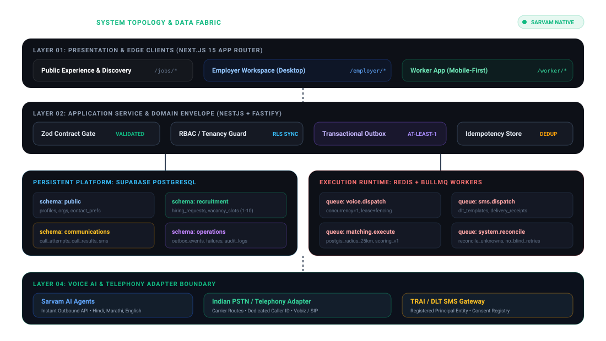
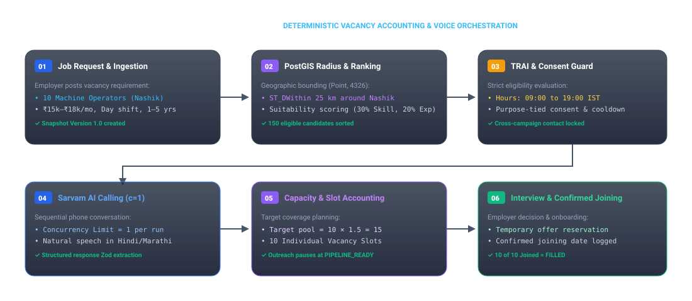

<div align="center">

# nayamarg. 2.0

### Voice-First Autonomous Recruitment Platform

[](https://nextjs.org/)
[](https://turbo.build/)
[](https://supabase.com/)
[](https://www.sarvam.ai/)
[](https://www.typescriptlang.org/)
[](https://tailwindcss.com/)

<p align="center">
  <strong>NayaMarg operates the full recruitment lifecycle on behalf of employers.</strong><br/>
  From job requirement ingestion and PostGIS spatial matching, to sequential conversational AI voice outreach in Hindi and Marathi, deterministic vacancy slot accounting, and verified candidate joinings.
</p>

</div>

---

## 1. System Topology & Architecture

NayaMarg is engineered as an **event-driven modular application** with an independent TypeScript workflow runtime and decoupled worker pools. Supabase PostgreSQL serves as the persistent source of truth, guarded by transactional outboxes, row-level security (RLS), and idempotent message consumers.

<p align="center">
  
</p>

### Technology Stack Commitments

| Layer | Technology | Operational Function |
| :--- | :--- | :--- |
| **Presentation Web** | Next.js 15 (App Router) + TypeScript | Public portal, desktop employer workspace, mobile-first worker PWA |
| **Styling & Motion** | Tailwind CSS + GSAP + Lenis Smooth Scroll | High-contrast dark editorial aesthetic, spring physics, fluid interactions |
| **API Backend** | NestJS + Fastify Adapter + Zod | Strict schema validation, OpenAPI, RBAC, and request tracing |
| **Primary Database** | Supabase PostgreSQL + PostGIS | 4 logical business schemas, geospatial indexing, spatial radius queries |
| **Authentication** | Supabase Auth (SSR Cookie Sessions) | Mobile-first OTP authentication, session revocation, tenant isolation |
| **Queue & Messaging** | Redis + BullMQ | Isolated queues (`voice.dispatch`, `sms.dispatch`, `matching.execute`) |
| **Workflow Runtime** | Custom TypeScript Orchestrator | Transactional outbox, bounded retries, deterministic state machines |
| **Voice Intelligence** | Sarvam AI Voice Agents | Natural conversational qualification in Hindi, Marathi, and English |
| **Telephony Adapter** | Indian PSTN / Vobiz Carrier Integration | Outbound attempt lifecycle, dedicated caller ID, webhook normalization |
| **SMS Gateway** | TRAI / DLT-Compliant Provider Adapter | Registered Principal Entity headers, approved templates, delivery receipts |

---

## 2. Autonomous Recruitment Engine Lifecycle

Unlike conventional job boards that merely blast phone numbers, NayaMarg features a dedicated **Autonomous Recruitment Orchestrator** that dynamically manages candidate discovery, voice qualification, employer interviews, and vacancy accounting.

<p align="center">
  
</p>

---

## 3. Core Architectural Invariants

The platform enforces ten fundamental engineering rules defined in [`docs/architecture/ENGINEERING_PRINCIPLES.md`](docs/architecture/ENGINEERING_PRINCIPLES.md):

1. **PostgreSQL is the single source of truth**: Redis, Sarvam, telephony, and SMS providers cannot independently declare final business outcomes.
2. **No hidden operations**: Every system action has a persistent database record, UUID, lifecycle state, and immutable audit log.
3. **No blind retries**: Uncertain external operations move to `UNKNOWN` and enter the reconciliation worker before any secondary side-effect is dispatched.
4. **No unrestricted admin access**: Admin roles, sensitive customer PII, and operations are governed by least-privilege RBAC and table grants.
5. **No automatic unsolicited outreach**: Candidate matching $\neq$ communication eligibility. Hard telecom consent and calling-hour gates must pass before calling.
6. **No fake functionality**: Interactive UI elements map to verified database contracts and real state transitions.
7. **No provider lock-in**: Sarvam AI and telephony networks run behind standardized TypeScript adapter interfaces (`VoiceProvider`, `SmsProvider`).
8. **No unnecessary microservices**: Business domains remain in a modular monorepo, scaling execution through dedicated BullMQ worker groups.
9. **No UI-led architecture**: Data models reflect authentic business transactions, not transient dashboard cards.
10. **No deployment without recovery tests**: The system is tested against worker crashes, duplicate webhooks, and provider outages.

---

## 4. Vacancy Management & Capacity Accounting

A candidate agreeing on a voice call does **not** mean the position is filled. NayaMarg enforces strict distinction between required vacancies, qualified interest, offer reservations, and confirmed joinings:

$$\text{Remaining Vacancies} = \max(0, \text{Required Vacancies} - \text{Filled Vacancies})$$

$$\text{Target Candidate Pool} = \lceil \text{Remaining Vacancies} \times \text{Coverage Factor} \rceil \quad (\text{Default } 1.5\times)$$

### Stage-Weighted Active Pipeline Formula

$$\text{Pipeline Score} = (0.35 \times \text{Interested}) + (0.55 \times \text{Shortlisted}) + (0.75 \times \text{Interviewed}) + (0.90 \times \text{Offer Pending})$$

- When $\text{Pipeline Score} \ge \text{Remaining Vacancies}$, outbound calling auto-pauses as **`PIPELINE_READY`**.
- Individual **`recruitment.vacancy_slots`** records (Slots 1 through 10) track reservations with lease expiries.
- A vacancy slot transitions to **`FILLED`** only upon verified joining confirmation.

---

## 5. Sequential Voice Call Scheduler (Concurrency = 1)

To guarantee high conversion quality and avoid concurrent double-dialing across distributed worker nodes, NayaMarg implements a transactional scheduler:

```typescript
// packages/workflow-engine/src/sequential-scheduler.ts
export class SequentialCallScheduler {
  async acquireCampaignSlot(campaignId: string, ttlMs: number = 45000): Promise<SequentialLease | null> {
    // 1. Transactional check in PostgreSQL for active lease
    // 2. Monotonic fencing token prevents split-brain across worker replicas
    // 3. Lease auto-expires if worker crashes before webhook callback
  }
}
```

### Telecom & Regulatory Compliance Gates (TRAI / DLT)
Every communication undergoes mandatory pre-flight evaluation before hitting Sarvam or SMS providers:
- **Calling Hours Window**: Strictly restricted between **09:00 and 19:00 IST** (UTC +5:30).
- **Daily Frequency Cap**: Maximum 3 call attempts per candidate across the platform.
- **Cooldown Interval**: Minimum 30 minutes between attempts to the same phone number.
- **Instant Opt-Out Suppression**: When a candidate states *"Stop calling me"*, the call classifier triggers an immediate global write to `communications.contact_suppressions`.

---

## 6. Four-Tier Database Architecture

The persistence platform is divided into four isolated PostgreSQL schemas:

```
supabase/migrations/
├── 001_initial_schemas.sql          # PostGIS, uuid-ossp, pgcrypto extensions
├── 002_identity_and_tenancy.sql     # profiles, organizations, memberships, preferences
├── 003_recruitment_and_vacancies.sql # PostGIS worker_profiles, hiring_requests, vacancy_slots
├── 004_communications_voice_sms.sql # consents, suppressions, voice_agents, call_attempts, SMS
├── 005_operations_automation_outbox.sql # outbox_events, webhook_inbox, failure_centre, audits
└── 006_rls_and_security.sql        # RLS policies, staff security-definer functions
```

### PostGIS Geospatial Radius Query (25 km Example)
```sql
SELECT
  user_id,
  ST_Distance(
    location,
    ST_SetSRID(ST_MakePoint(73.7898, 19.9975), 4326)::geography
  ) / 1000.0 AS distance_km
FROM recruitment.worker_profiles
WHERE ST_DWithin(
  location,
  ST_SetSRID(ST_MakePoint(73.7898, 19.9975), 4326)::geography,
  25000 -- 25 km in meters
)
ORDER BY distance_km ASC;
```

---

## 7. Monorepo Structure

```text
nayamarg/
├── apps/
│   └── web/                         # Next.js 15 App Router (Tailwind + GSAP + Lenis)
│       ├── app/                     # Customer-facing website & portal routes
│       ├── components/              # Luxury dark editorial components (artfolio aesthetic)
│       └── public/
├── packages/
│   ├── contracts/                   # Zod schemas, domain event envelopes, API contracts
│   ├── domain/                      # State machines, scoring algorithm, vacancy planner
│   ├── providers/                   # Sarvam AI adapter, Telephony adapter, DLT SMS gateway
│   └── workflow-engine/             # Sequential scheduler, outbox processor, reconciler
├── supabase/
│   └── migrations/                  # Production PostgreSQL migrations
├── docs/
│   ├── architecture/                # System documentation & engineering principles
│   └── assets/                      # High-resolution architectural vector diagrams
├── turbo.json                       # Turborepo task pipeline configuration
├── pnpm-workspace.yaml              # Monorepo workspace boundaries
└── package.json
```

---

## 8. Local Development & Quickstart

### Prerequisites
- **Node.js**: `v20.x` or `v22.x`+
- **pnpm**: `v9.x` (`corepack enable pnpm`)

### Installation & Run

```bash
# 1. Clone repository
git clone https://github.com/anshrajore/nayamarg.git
cd nayamarg

# 2. Install workspace dependencies
pnpm install

# 3. Build workspace packages
pnpm build

# 4. Start Next.js web application
pnpm --filter @nayamarg/web dev
```

Open [http://localhost:3000](http://localhost:3000) to view the running application.

---

## 9. Failure Centre & Provider Reconciliation

System failures are classified into seven distinct root-cause categories:
1. `TRANSIENT_SYSTEM` (Network timeouts, exponential backoff)
2. `PERMANENT_VALIDATION` (Schema mismatch, unroutable destination)
3. `EXTERNAL_PROVIDER` (Telephony timeout, unknown Sarvam attempt state)
4. `BUSINESS_OUTCOME` (Candidate salary expectation mismatch)
5. `COMPLIANCE_SUPPRESSION` (TRAI calling window closed, DND active)
6. `MANUAL_INTERVENTION_REQUIRED` (Candidate identity dispute)
7. `DATA_QUALITY` (Incomplete worker profile, expired certifications)

When a call dispatch encounters an unconfirmed state, it moves to `UNKNOWN`. The background reconciler polls the Sarvam Analytics API by provider attempt reference before any retry is permitted.

---

<div align="center">

**NayaMarg Technologies Pvt. Ltd. © 2026**<br/>
*Engineered for high-reliability, compliant, voice-first recruitment operations.*

</div>
